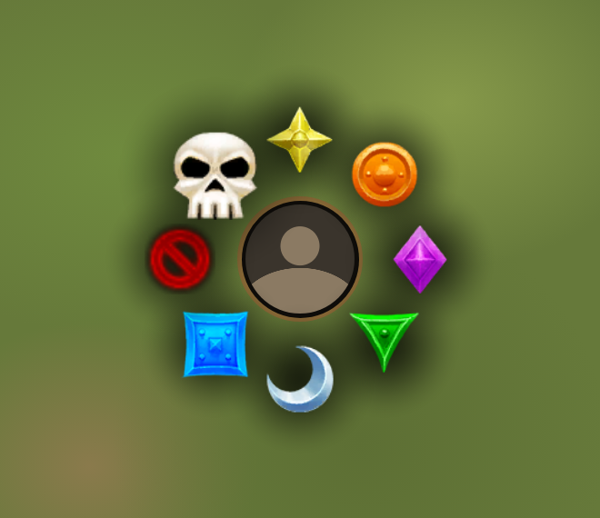
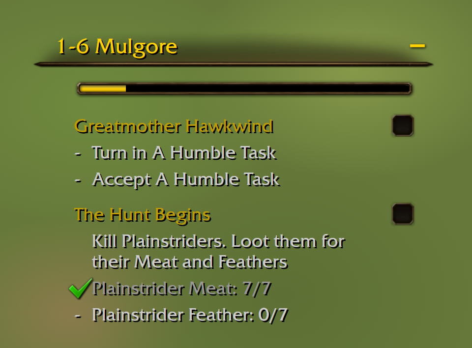
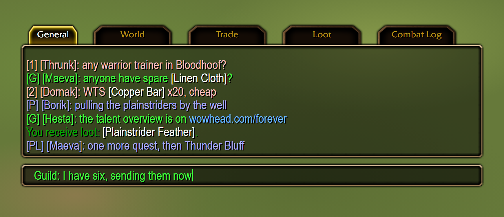
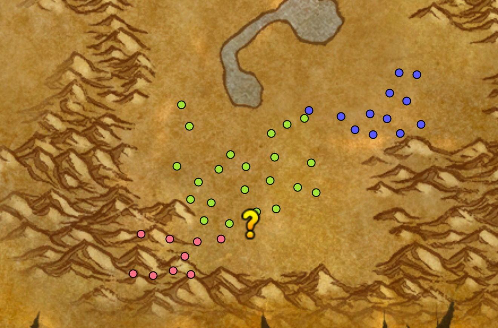
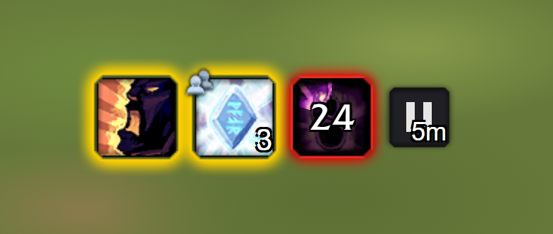
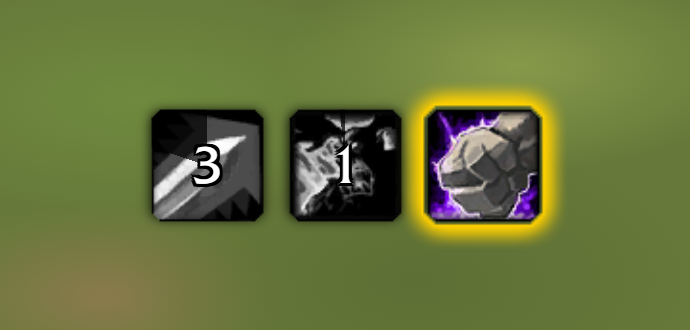
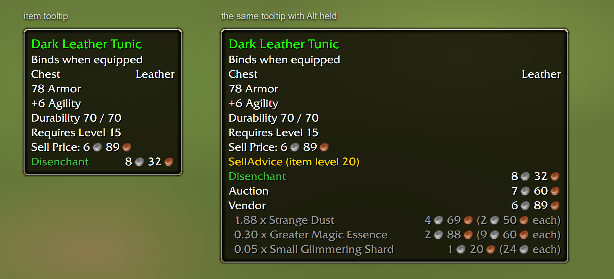
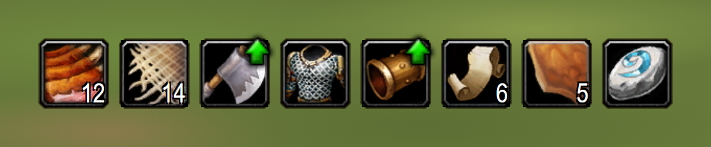
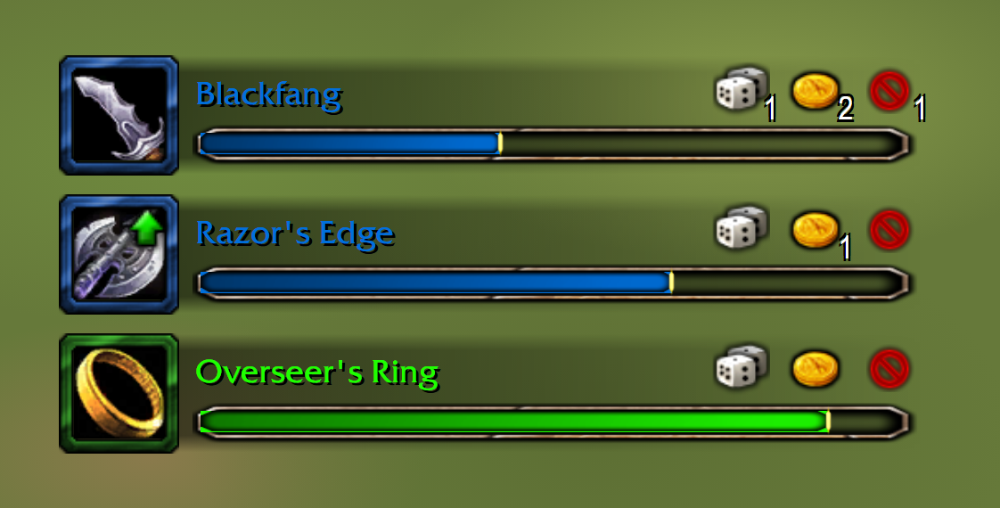

# wow-forever-addons

Addons I wrote for WoW Forever (interface 16001). Each folder under `addons/`
is one addon: copy it into the game's `Interface/AddOns` and `/reload`.

| Addon | What it does |
| --- | --- |
| BuffNag | Shows an icon, and pings, while a buff you chose is missing on you or your party. Configured from a tab in the Cooldown Manager's settings. /bn |
| CooldownNag | An icon pops up a few seconds before an ability you chose comes off cooldown, and stays a moment once it is ready. Configured from a tab in the Cooldown Manager's settings. /cdn |
| FishClick | With a fishing pole equipped, double-click into the world to cast your line. /fish |
| ForeverChat | The default chat in Forever's own style, with short channel names and one chat setup shared by all your characters. /fchat |
| ForeverGuide | Leveling guides inside the quest tracker. Reads RestedXP and WoW-Pro guides, tracks the quests of the current step, points an arrow and sets the map pin. /fg |
| ForeverQuests | Quest log and tracking tweaks. Spawn dots for tracked quests on the map and minimap instead of the quest areas and in-progress icons. /fq |
| LootRolls | Movable group loot roll bars in the XLoot layout: icon, timer bar with the item name, Need/Greed/Pass with how many chose each and who (hover). /lootrolls |
| NameOnly | Friendly player nameplates show just the name: your font, size and position. /nameonly |
| NodeSkill | Colours a herb or ore node's name on the minimap tooltip red when your skill is too low to gather it. |
| PetAuras | Your pet's buffs and debuffs as small icons under the pet frame, drawn by the game's own aura buttons. |
| PlateTarget | Enemy nameplates show who the enemy is targeting, under the bar (below the cast bar while casting); class colours; YOU when it is you, green for tanks, red otherwise. |
| QuestTarget | Marks the nameplates of enemies you still need for a quest. |
| SellAdvice | One line in item tooltips: disenchant, vendor or auction, whichever brings the most, from Auctionator's scanned prices. A gold coin marks the quest choice worth the most. Hold Alt for the workings. |
| SimpleRaidTargetIcons | Modifier-click or double-click a unit to pick its raid target icon from a radial menu around the cursor. Out of combat only; key bindings work in combat. |
| ThreatColor | Enemy nameplate bars coloured by your threat: green, yellow, orange, red. /threatcolor |
| TrackSwap | Alternates minimap tracking between Find Herbs and Find Minerals every few seconds, so both kinds of node show up. /ts |
| UpgradeArrow | Pawn lite: a green arrow on items that would be an upgrade for your class and role, in Baganator's bags, quest rewards and LootRolls bars. /upgradearrow |

Some of them build on other addons (QuestieDB, Auctionator, Baganator, the
Cooldown Manager); each addon's `.toc` names what it needs or can use.

## What they look like

These are mock-ups, not screenshots: drawn outside the game from the game's own
art and font at the sizes the addon code uses. The background, the numbers and
the names in them are stand-ins.

**SimpleRaidTargetIcons.** The radial menu. The target already has the cross, so that slot shows the pass sign.

**ForeverGuide.** The guide as a section of the quest tracker, with its progress bar.

**ForeverChat.** The chat window, tabs and input box in Forever's style, with short channel names.

**ForeverQuests.** Spawn dots of three tracked quests on the map, and a turn-in marker.

**BuffNag.** A buff missing on you, one missing on three of the party, one running out, and the pause button.

**CooldownNag.** Two abilities seconds from ready and one that is ready.

**SellAdvice.** The advice line in an item tooltip, and the workings with Alt held.

**UpgradeArrow.** The green arrow on two items in a row of bag slots.

**LootRolls.** Three roll bars with how many chose need, greed and pass.

## ForeverGuide needs guide files

ForeverGuide has no guides of its own. It loads the guide files of RestedXP
Guides and WoW-Pro Leveling unchanged. Both are under non-commercial
licences, so they are not in this repository:

    make guides

fetches them into `addons/ForeverGuide/Guides` (needs git and Python 3).
Without this step ForeverGuide does not load.

## Working on them

    make check      # compile every addon, catch locals used before definition (needs luac 5.1)
    make guides
    make install    # check, then have ../wow-addons copy everything into the game

`make install` relies on a second, private repo of mine that vendors other
people's addons and copies both sets into the game. Without it, copy the
folders by hand.

`scripts/` holds the generators for files that are committed:
`sell-advice-data.py` (SellAdvice's `Data.lua`), `make-dot-tga.py`
(ForeverQuests' `dot.tga`) and `icon_sheets.py` (SimpleRaidTargetIcons' icon
sheets).
