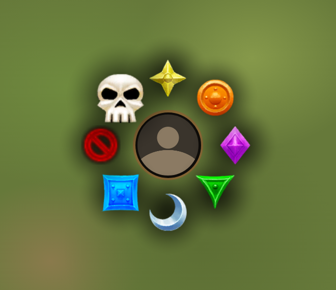
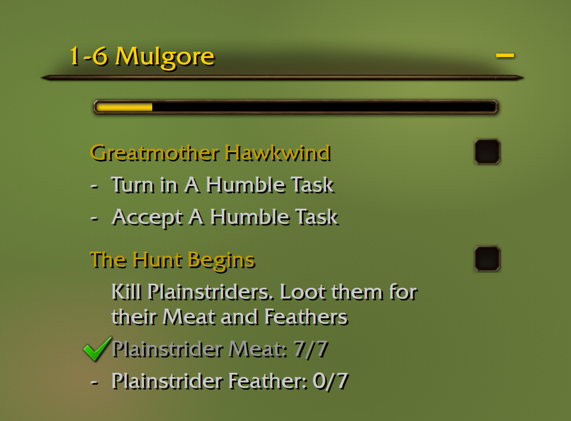
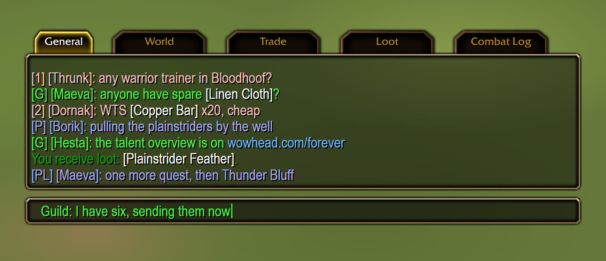
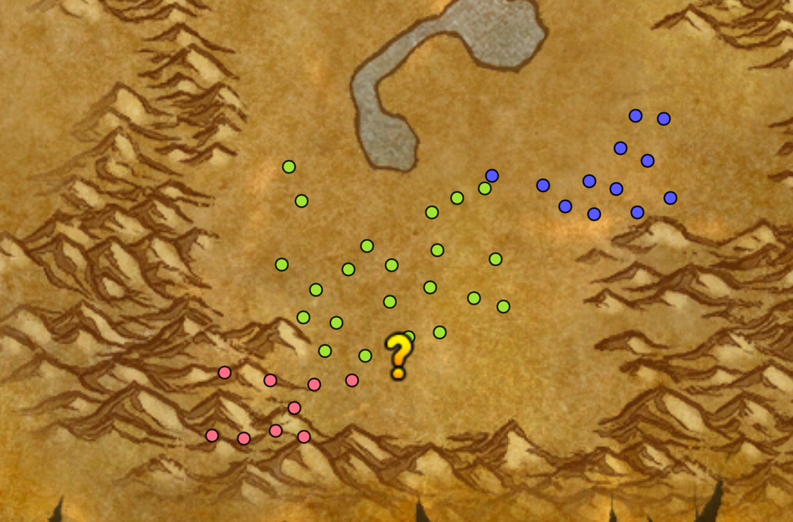
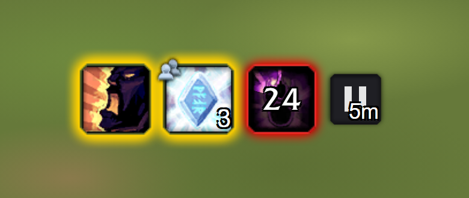
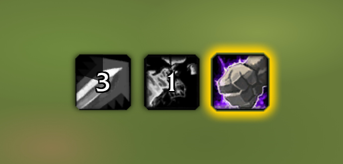
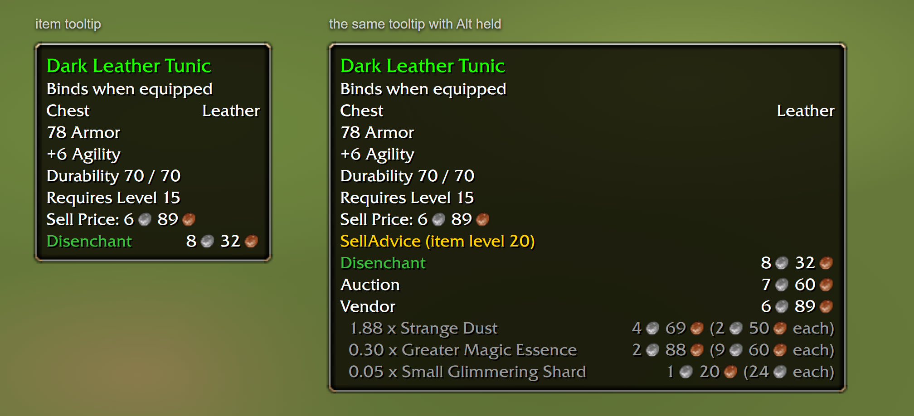
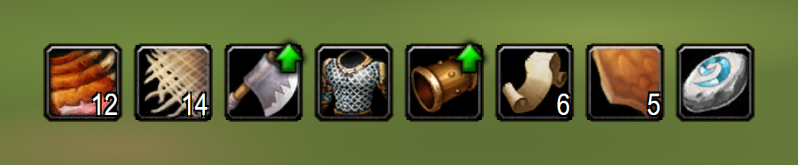
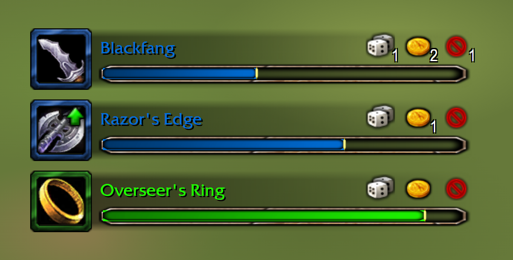

# wow-forever-addons

Addons I wrote for WoW Forever (interface 16001). Each folder under `addons/`
is one addon: copy it into the game's `Interface/AddOns` and `/reload`.

Downloads, one zip per addon: https://pietjan.github.io/wow-forever-addons/

| Addon | What it does |
| --- | --- |
| BuffNag | Shows an icon, and pings, while a buff you chose is missing on you or your party. Configured from a tab in the Cooldown Manager's settings. /bn |
| BulkInbox | A list beside the inbox of every item and sum of money in your mail: take all, the money, or the rows you mark. One take at a time, C.O.D. never paid, stops cleanly on full bags. /bulkinbox |
| CompactTip | Unit tooltips you can read at a glance: one line per quest objective naming only who still needs it, names in class colour, and item and spell IDs while Alt is held. |
| CombatScroll | Scrolling combat text in two columns: what you take falls on the left, your own damage and healing rise on the right with the spell's icon. Needs its own combat log filter (/cscroll setup). /cscroll |
| CooldownNag | An icon pops up a few seconds before an ability you chose comes off cooldown, and stays a moment once it is ready. Configured from a tab in the Cooldown Manager's settings. /cdn |
| CraftProfit | A list of what your characters can craft, best profit first, from Auctionator's scanned prices: sale price after the cut (the lower of the last scan and the median), less materials at the cheaper of auction and vendor. Recipes are read when each character opens its profession window. Click recipes to plan crafts: the Materials pane lists what to buy after what you own, and makes an Auctionator shopping list. Could learn adds recipes a character could learn now, from trainers and patterns (auction or vendor), with how many crafts pay for learning them. /profit. /farm lists raw goods worth farming to sell, with this week's price and supply against last week's. |
| ForeverData | WoW Forever's game data for other addons, with no window of its own: items, creatures, objects, quests and zones, what drops where and how often (counted in Forever where known), where things stand, who sells and teaches what, and a search over their names. Read through the global `ForeverData` table. Data from ForeverDB.net (https://foreverdb.net), CMaNGOS classic-db, wowhead and QuestieDB; see its NOTICE.txt. |
| ForeverSearch | Spotlight for WoW Forever: a floating search bar; type and the best matches for any item, creature, object, quest or zone appear under it, forgiving typos and missing letters. The chosen one's details show beside the list: for an item where it drops, is skinned, fished or found, each with its chance and whether that was counted in Forever, who sells it, its auction price (Auctionator) and how many your characters own (Syndicator); for a creature or object where it stands and what it gives. Words narrow the search: `item:` `npc:` `object:` `quest:` `zone:`, `q:rare` (grey items are left out unless a `q:` is typed, `q:poor` for all), `lvl:40-50`, `in:hinterlands` (creatures and objects there, and the items they give; a subzone such as `in:goldshire` stands for its zone; a full name with dashes, `in:blackrock-depths`, is that zone only). `from:saltwater-snapjaw` is what a creature or object gives or a vendor sells; `type:sword`, `type:cloth`, `type:recipe` an item type, as the game names types; `is:rare`, `is:elite`, `is:boss` creatures of that rank; `is:repeatable`, `is:new` (new in Forever), `class:shaman`, `skill:fishing` quests. `is:dungeon`, `is:battleground` instances (`is:raid` too, once a raid opens: until then raids, their bosses and loot, and Season of Discovery's leftovers are not in the data); the usual abbreviations name places, alone or after `in:` (`brd`, `ubrs`, `dm`, `stv`, `wsg`, ...); a creature's title finds it too (`banker`, `weapon master`), and `flight master` (or `fp`) finds every gryphon, wind rider, hippogryph and bat master; a bare word puts places, bosses and materials first (`scarlet` Scarlet Monastery, `silk` Silk Cloth); the other faction's quests and people are left out unless you type `side:both` (or `side:alliance`, `side:horde`); a zone that is one says Dungeon or Raid. On the pages these words are links: "and N more" under a list, a creature's rank, a quest's class or profession, a zone's level range. Buttons under the bar set the same words for you: a kind (Tab steps through them), a quality or better, Near me (your level), Here (your zone). In a dungeon or raid the bar opens with `in:` that instance filled in. Names in the details are links, as on wowhead: click a creature, item or zone to see its page, Back to return; a zone's page lists what stands there. Click a zone in the results, or Search in on its page, to search that zone. A line above the results says how the filter words were read. Shift-click or Shift-Enter links an item. Needs ForeverData. /find, or a key under Key Bindings > AddOns. |
| FishClick | With a fishing pole equipped, double-click into the world to cast your line. /fish |
| ForeverChat | The default chat in Forever's own style, with short channel names and one chat setup shared by all your characters. /fchat |
| ForeverGuide | Leveling guides under the quest tracker. Reads RestedXP and WoW-Pro guides, tracks the quests of the current step, points an arrow and sets the map pin. /fg |
| ForeverRecorder | Records what the game shows you, for the offline database (wow-forever-data): what each creature, node, chest and fishing spot gave when looted, counted per corpse; what vendors sell, with prices and limited stock, and your standing and Bartering rank, which those prices are discounted by; who offers and takes quests and what they reward; creatures' names, levels and kinds; where these stand. Only out of combat, where the game gives addons these values; a value the game keeps secret is left out and counted. Game facts only: no character names, realms or GUIDs. /recorder shows what it has and what the game refused. |
| ForeverQuests | Quest log and tracking tweaks. Spawn dots for tracked quests on the map and minimap instead of the quest areas and in-progress icons. /fq |
| ForeverPlates | Nameplate tweaks, each one on or off: friendly players show just the name (your font, size and position); enemy bars coloured by your threat, and your threat as a number beside them; who each enemy is targeting under its bar, YOU when it is you; a quest mark on enemies you still need; the level box hidden if you like. /fplates |
| ForeverSparkles | A sparkle over herbs, ore veins and quest objects as you come near. Each kind has its own page of sliders: glint size, spread, number of glints, brightness, colour, pace, lifetime, height and drift. Can also keep the game's own loot sparkle on. /fsparkles |
| GroupDebuffs | The debuffs your group's classes should keep on the target, as a column or row of icons: dim while missing, lit with its timer while it is on. Options > AddOns, or /groupdebuffs |
| HealerMana | The mana of your group's healers as a column of rows: class icon, name, percentage (or dead or offline), and an icon while drinking, innervated or soulstoned. /healermana to move it. |
| LootFeed | A short list of what you just picked up: items with how many you now carry, money, reputation, experience and honor, and what your group loots. Each line fades after a few seconds. /lootfeed |
| LootRolls | Movable group loot roll bars in the XLoot layout: icon, timer bar with the item name, Need/Greed/Pass with how many chose each and who (hover). /lootrolls |
| PetAuras | Your pet's buffs and debuffs as small icons under the pet frame, drawn by the game's own aura buttons. |
| SellAdvice | One line in item tooltips: disenchant, vendor or auction, whichever brings the most, from Auctionator's scanned prices. A gold coin marks the quest choice worth the most. Hold Alt for the workings. /sell lists everything your characters own (from Syndicator), best to sell first, with a low/high price note. |
| SimpleRaidTargetIcons | Modifier-click or double-click a unit to pick its raid target icon from a radial menu around the cursor. Out of combat only; key bindings work in combat. |
| TargetDebuffs | The debuffs you put on your target as a free-standing row of icons that the mouse passes through. /targetdebuffs to move it. |
| ToastAnchor | Puts the game's alert popups (loot you won, achievements and the like) where you want them. /toastanchor |
| TrackSwap | Alternates minimap tracking between Find Herbs and Find Minerals every few seconds, so both kinds of node show up. /ts |
| UpgradeArrow | Pawn lite: a green arrow on items that would be an upgrade for your class and role, in Baganator's bags, quest rewards and LootRolls bars. /upgradearrow |
| UpgradeFinder | A list of the gear that would be an upgrade for you, slot by slot, with where each piece comes from: quest, drop, vendor, chest or profession. Scored by UpgradeArrow, sources from QuestieDB. /upgrades |

Some of them build on other addons (QuestieDB, Auctionator, Baganator, the
Cooldown Manager); each addon's `.toc` names what it needs or can use.

## What they look like

These are mock-ups, not screenshots: drawn outside the game from the game's own
art and font at the sizes the addon code uses. The background, the numbers and
the names in them are stand-ins.

**SimpleRaidTargetIcons.** The radial menu. The target already has the cross, so that slot shows the pass sign.

**ForeverGuide.** The guide, drawn like a section of the quest tracker and placed under it, with its progress bar.

**ForeverChat.** The chat window, tabs and input box in Forever's style, with short channel names.

**ForeverQuests.** Spawn dots of three tracked quests on the map, and a turn-in marker.

**BuffNag.** A buff missing on you, one missing on three of the party, one running out, and the pause button.

**CooldownNag.** Two abilities seconds from ready and one that is ready.

**SellAdvice.** The advice line in an item tooltip, and the workings with Alt held.

**UpgradeArrow.** The green arrow on two items in a row of bag slots.

**LootRolls.** Three roll bars with how many chose need, greed and pass.

## ForeverGuide needs guide files

ForeverGuide has no guides of its own. It loads the guide files of RestedXP
Guides and WoW-Pro Leveling unchanged. Both are under non-commercial
licences, so they are not in this repository:

    make guides

fetches them into `addons/ForeverGuide/Guides` (needs git and Python 3).
Without this step ForeverGuide does not load.

## Working on them

    make audit                # compile every addon, catch locals used before definition (needs luac 5.1)
    make guides
    make install              # audit, then have ../wow-addons copy everything into the game
    make versions             # every addon's version, and whether it is released
    make package/<addon>      # zip one addon's committed files into dist/
    make release/<addon>      # publish that zip as a GitHub release (needs the gh CLI)
    make site                 # write docs/index.html, the downloads page (commit it after a release)

`make install` relies on a second, private repo of mine that vendors other
people's addons and copies both sets into the game. Without it, copy the
folders by hand.

Each addon is released on its own. Its version is the `## Version:` line of
its `.toc`; `make release/<addon>` publishes that version as the tag
`<addon>-v<version>` with `<addon>-<version>.zip` attached, and asks before
it does. It refuses when the addon has uncommitted changes, when the current
commit is not on GitHub yet, or when that version is already released: raise
the version in the `.toc` first. The notes list the commits that touched the
addon since its previous release. ForeverGuide's zip has no guide files, for
the reason given above.

ForeverData's `Data/` is generated by `forever addon` in wow-forever-data,
the offline database it is read from; `scripts/foreverdata-test.lua`
(`make test`) checks its API offline. ForeverData is GPL-3.0 with
ForeverDB.net's attribution term (its LICENSE.txt and NOTICE.txt): credit
"Data from ForeverDB.net (https://foreverdb.net)" where you reuse its data.

`scripts/` holds the generators for files that are committed:
`sell-advice-data.py` (SellAdvice's `Data.lua`), `upgrade-finder-data.py`
(UpgradeFinder's `Data.lua`), `make-dot-tga.py` (ForeverQuests' `dot.tga`)
and `icon_sheets.py` (SimpleRaidTargetIcons' icon sheets).
